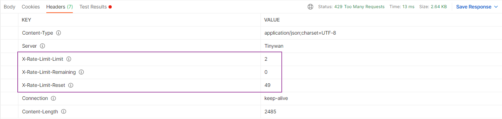

# based on lua script limiting traffic for webman plugin

[](https://packagist.org/packages/tinywan/limit-traffic) [](https://packagist.org/packages/tinywan/limit-traffic) [](https://packagist.org/packages/tinywan/limit-traffic) [](https://packagist.org/packages/tinywan/limit-traffic)

为防止滥用，你应该考虑对您的 API 限流。 例如，您可以限制每个用户 10 分钟内最多调用 API 100 次。 如果在规定的时间内接收了一个用户大量的请求，将返回响应状态代码 429 (这意味着过多的请求)。
## 安装

```shell
composer require tinywan/limit-traffic
```

## 使用

### 应用中间件

在 `config/middleware.php` 中添加全局中间件如下：

```php
return [
    // 全局中间件
    '' => [
        // ... 这里省略其它中间件
        Tinywan\LimitTraffic\Middleware\LimitTrafficMiddleware::class,
    ],
    // api应用中间件
    'api' => [
        Tinywan\LimitTraffic\Middleware\LimitTrafficMiddleware::class,
    ]
];
```

### 路由中间件

> 注意：需要 `workerman/webman-framework` 版本 `>= 1.0.12`

我们可以给某个一个或某一组路由设置中间件。例如在 `config/route.php` 中添加如下配置：

```php
Route::any('/admin', [app\admin\controller\Index::class, 'index'])
->middleware([Tinywan\LimitTraffic\Middleware\LimitTrafficMiddleware::class]);

// 分组路由
Route::group('/blog', function () {
   Route::any('/create', function () {return response('create');});
})->middleware([Tinywan\LimitTraffic\Middleware\LimitTrafficMiddleware::class]);
```

## 🔏 返回允许的请求的最大数目及时间

返回允许的请求的最大数目及时间，例如：`[100, 600]` 表示在 `600` 秒内最多 `100` 次的 API 调
```php
Tinywan\LimitTraffic\RateLimiter::getRateLimit(); // 返回 [100, 600]
```

## ⚠ 请求限制参考



## 🔰 响应参数详解

- `X-Rate-Limit-Limit` 同一个时间段所允许的请求的最大数目
- `X-Rate-Limit-Remaining` 在当前时间段内剩余的请求的数量
- `X-Rate-Limit-Reset` 为了得到最大请求数所等待的秒数

## 自定义自己的 Response

> 使用场景
- 每个项目有标准的统一输出，自定义返回内容
- 前后端分离：前端要求返回的 `HTTP状态码`并不是 `429`，而是 `200` 或者其他
- 响应的`body`不是 `{"code":0,"msg":"Too Many Requests"}`，而是 `{"error_code":200,"message":"Too Many Requests"}`等其他内容

### 自定义HTTP状态码

编辑 `config/plugin/tinywan/limit-traffic/app.php` 文件的 `status` HTTP 状态码（默认值是 `429`）

### 自定义限流键

编辑 `config/plugin/tinywan/limit-traffic/app.php` 文件的 `limit_key` 限流键（默认值是 `none`）

- `none 代表以ip作为限流键`
- `get.id 代表以get请求的id作为限流键`
- `post.access 代表以post请求的access作为限流键`
- `header.token 代表以header请求的token作为限流键`

### 自定义`body`返回内容

编辑 `config/plugin/tinywan/limit-traffic/app.php` 文件的 `body` 的字段

**默认选项是**
```json
{
	"code": 0,
	"msg": "Too Many Requests",
	"data": null
}
```
**自定义选项参考一**

1、假设`status` HTTP 状态码设置为 `200`

2、假设`body`的数组设为为

```php
'body' => [
	'error_code' => 200,
	'message' => '请求太多请稍后重试'
]
```

则响应内容为
```json
HTTP/1.1 200 OK
Content-Type: application/json;charset=UTF-8

{
	"error_code": 200,
	"message": "请求太多请稍后重试"
}
```
其他的可以根据自身业务自定义即可

## Other

```php
vendor/bin/phpstan analyse src

vendor/bin/php-cs-fixer fix src
```
